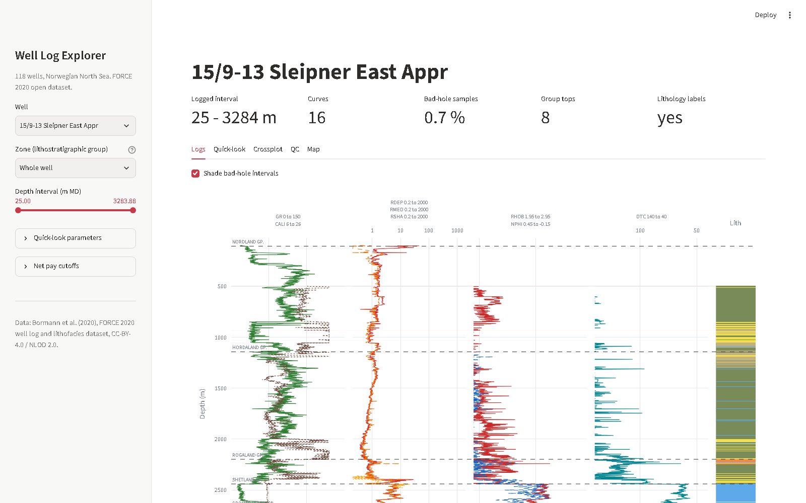
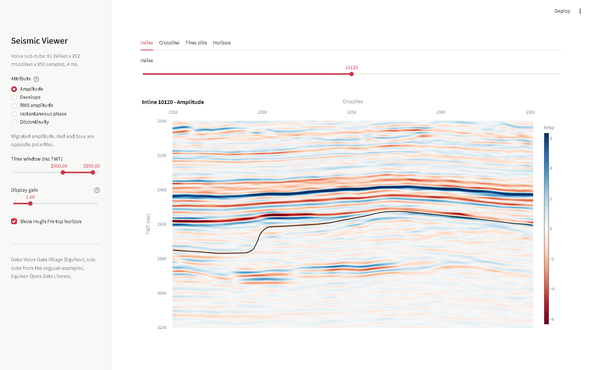
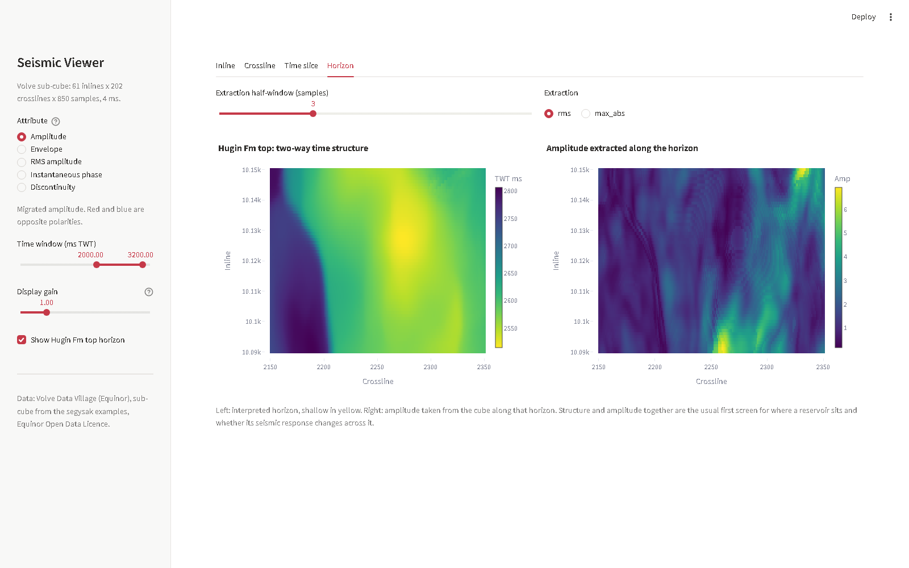
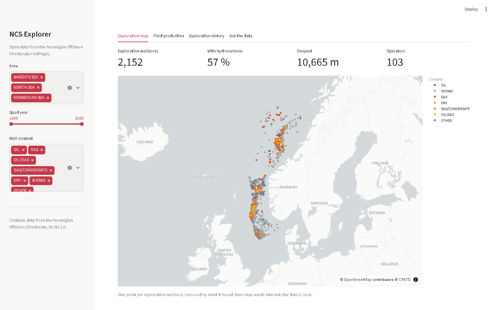
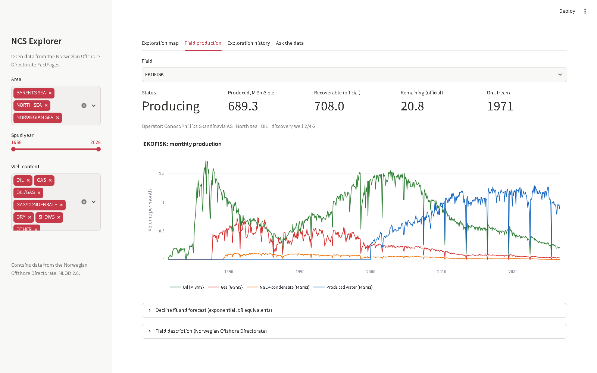
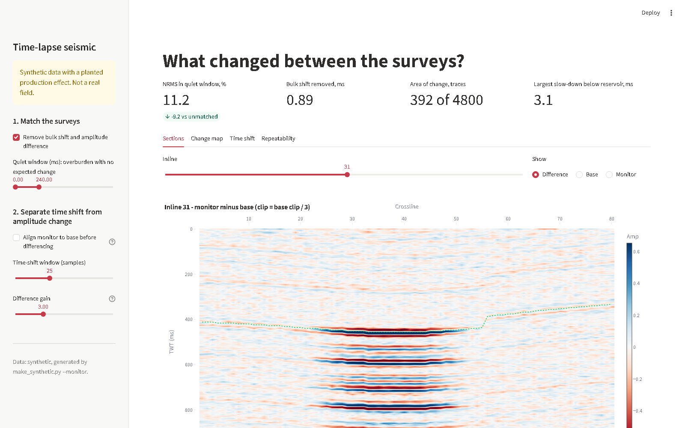
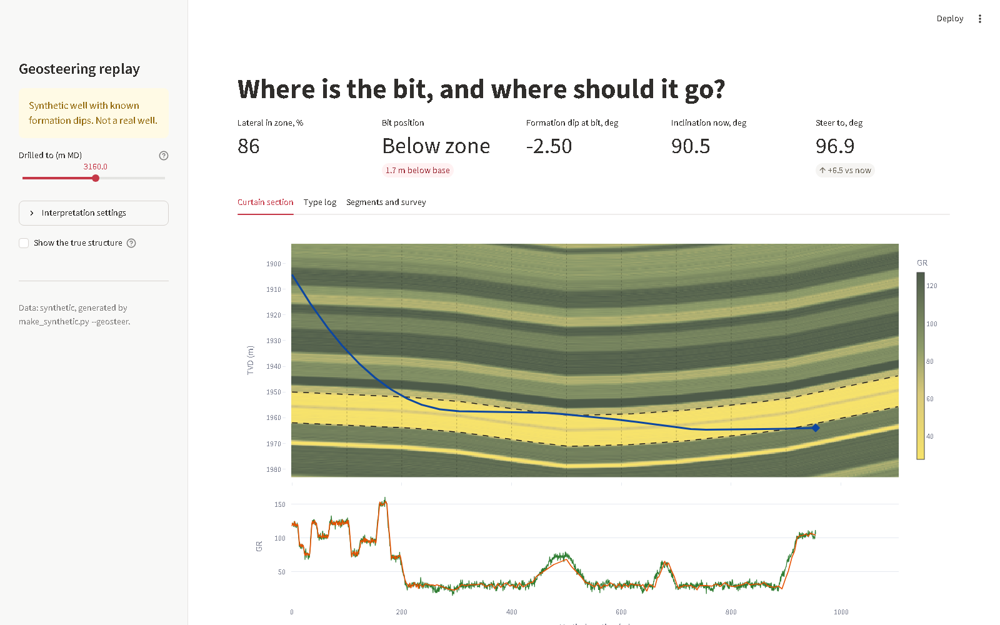

# subsurface-app-builder

A [Claude Code](https://claude.com/claude-code) skill for building apps on subsurface data: well logs (LAS), 3D and 4D seismic (SEG-Y), horizontal wells and open Norwegian continental shelf data. It comes with five demo apps built with it: three on public data and two on synthetic data with known answers.

The skill gives the coding agent what a geoscientist would otherwise have to explain every time: how to inspect a LAS or SEG-Y file without reading it, which curve names mean the same thing, how logs and seismic are conventionally displayed, the quick-look petrophysics formulas, where the open data is and what is odd about it, and the mistakes that cost time when building these apps.



## What is in the repository

| Path | Content |
|---|---|
| `skills/subsurface-app-builder/` | The skill: `SKILL.md`, ten reference documents, helper scripts, two app templates |
| `demos/01_well_log_explorer/` | Browse 118 North Sea wells: log tracks, lithology, bad-hole flags, quick-look net pay per zone, crossplots, QC table, map |
| `demos/02_seismic_viewer/` | Inline, crossline and time-slice viewer for a Volve sub-cube with five attributes, a horizon overlay and amplitude extraction |
| `demos/03_ncs_explorer/` | Exploration wells, field production with decline fit, exploration history, and plain-language questions answered with SQL |
| `demos/04_time_lapse/` | 4D seismic on a synthetic base and monitor survey: matching, repeatability, time shifts, and maps of what changed at the reservoir |
| `demos/05_geosteering/` | Replay of a synthetic horizontal well: formation dips fitted to the gamma ray, curtain section, share of the well in the target, steering advice |
| `scripts/prepare_synthetic.py` | Generates the synthetic data for demos 04 and 05 (seconds, no network) |
| `scripts/download_sample_data.py` | Fetches the open sample data (about 230 MB) into `data/` |
| `tests/` | Tests for the helper scripts and headless smoke tests of the demos |

## Install the skill

Copy the skill folder into your Claude Code skills directory:

```bash
git clone https://github.com/AdoringStarling/subsurface-app-builder
# macOS / Linux
cp -r subsurface-app-builder/skills/subsurface-app-builder ~/.claude/skills/
# Windows (PowerShell)
Copy-Item -Recurse subsurface-app-builder\skills\subsurface-app-builder $env:USERPROFILE\.claude\skills\
```

Start a new Claude Code session and ask for something like:

- "Here is a folder of LAS files. Build me an app to QC them and compute net pay."
- "This SEG-Y will not load as a cube. Find out why and make a viewer."
- "Make a dashboard of production decline for fields in the Norwegian Sea."
- "I am going to an energy hackathon. Suggest three projects I can build alone in two days."

## Run the demos

Python 3.11 or newer.

```bash
python -m venv .venv
.venv/Scripts/activate            # Windows;  source .venv/bin/activate elsewhere
pip install -r requirements.txt

python scripts/download_sample_data.py
python skills/subsurface-app-builder/scripts/las_to_parquet.py data/force2020/las data/force2020/wells.parquet
python skills/subsurface-app-builder/scripts/segy_to_npy.py data/volve/volve10r12-full-twt-sub3d.sgy data/volve/volve_sub3d

streamlit run demos/01_well_log_explorer/app.py
streamlit run demos/02_seismic_viewer/app.py
streamlit run demos/03_ncs_explorer/app.py

python scripts/prepare_synthetic.py          # demos 04 and 05 need only this
streamlit run demos/04_time_lapse/app.py
streamlit run demos/05_geosteering/app.py
```

The "Ask the data" tab of the third demo needs `ANTHROPIC_API_KEY` in the environment. Everything else runs without it. Base-map tiles need internet; all data is local.

| | |
|---|---|
|  |  |
|  |  |
|  |  |

## Helper scripts

All in `skills/subsurface-app-builder/scripts/`, usable on their own:

| Script | Purpose |
|---|---|
| `inspect_las.py` | Summarise one LAS file or a folder as compact JSON: curves, families, coverage, value ranges, unit and quality flags |
| `inspect_segy.py` | Describe a SEG-Y file from its headers: geometry and byte positions, sampling, coordinates, amplitude clip |
| `las_to_parquet.py` | Convert a folder of LAS files to one table with harmonised names, metres and fixed units |
| `segy_to_npy.py` | Convert a 3D SEG-Y, or a crop, to a memory-mappable cube with metadata |
| `fetch_factpages.py` | Download and cache Norwegian Offshore Directorate FactPages tables |
| `make_synthetic.py` | Generate plausible synthetic wells, a seismic cube, a 4D monitor survey and a horizontal well for tests |
| `screenshot_app.py` | Start a Streamlit app, click through its tabs and save a screenshot of each |
| `subsurface_utils.py` | Curve aliases, loading, quick-look petrophysics, FactPages in DuckDB, coordinates, horizons |
| `subsurface_plots.py` | Log tracks, crossplots, seismic sections and slices in Plotly |
| `seismic_attributes.py` | Envelope, instantaneous phase and frequency, RMS amplitude, semblance |
| `time_lapse.py` | 4D seismic: repeatability (NRMS), matching, time shifts, aligned difference, change maps |
| `geosteering.py` | Well path by minimum curvature, structure model from a type log, automatic dip fit, steering advice, curtain section |
| `ask_data.py` | Questions over DuckDB tables answered by a model that writes read-only SQL |

## Tests

```bash
pytest -q
python scripts/screenshots.py     # optional: needs  python -m playwright install chromium
```

Script tests run on synthetic data. Demo smoke tests are skipped when the sample data has not been downloaded.

## Limitations

- Petrophysics is quick-look only: no environmental corrections, one water resistivity per interval, clean-sand Archie, measured-depth thickness.
- The seismic helpers handle 3D post-stack volumes. 2D lines, pre-stack data and irregular geometries are described in the reference but not automated.
- Wells are shown on seismic in map view only; a time-depth relation is needed to place them on time sections.
- The 4D and geosteering demos run on synthetic data. The methods are tested against the planted answers, not against real surveys or wells.
- Geosteering uses gamma ray only, parallel beds of constant thickness and no faults.
- The decline forecast in the third demo is a screening estimate from a simple exponential fit.
- The plain-language query feature was tested with a simulated model, not against the live API.

## Data and licences

Code: MIT, see `LICENSE`. No data is included in the repository.

- Well logs: Bormann P., Aursand P., Dilib F., Dischington P., Manral S. (2020). *FORCE 2020 Well well log and lithofacies dataset for machine learning competition*. Zenodo, doi:10.5281/zenodo.4351156. CC-BY-4.0; underlying data NLOD 2.0.
- Seismic, horizon and well path: Volve Data Village, Equinor, under the Equinor Open Data Licence; sub-volume from the [segysak](https://github.com/trhallam/segysak) examples.
- FactPages: contains data from the Norwegian Offshore Directorate, NLOD 2.0.
